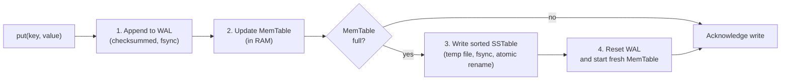
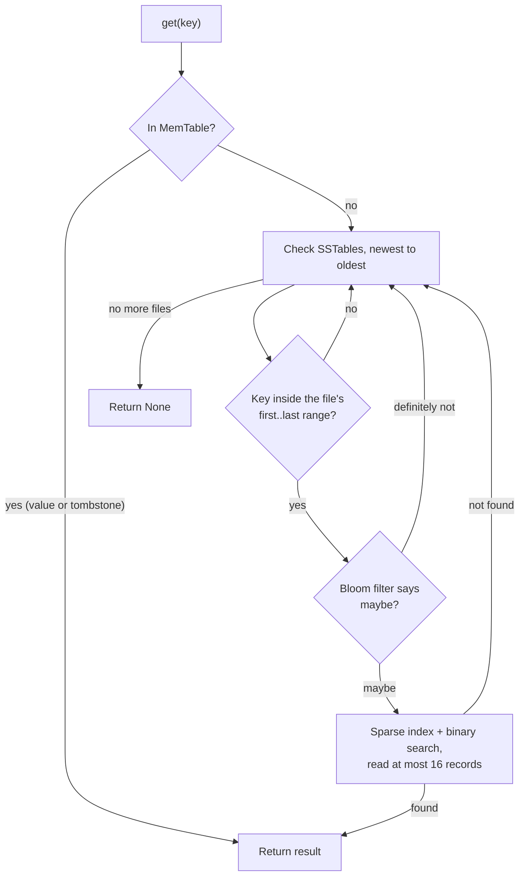

# Strata

**A key-value database engine built from scratch in Python, using the same LSM-tree design behind RocksDB and Cassandra.**

Strata never loses a write it has acknowledged. You can kill the process at a random moment and every acknowledged key is still there after restart.

> 📽️ **Demo GIF goes here** (kill the writer mid-flush, restart, show all keys recovered)

  

---

## Why I built this

Most apps treat the database as a black box. I wanted to understand what actually happens between `put("key", "value")` and the bytes landing safely on disk, so I built one.

The core problem is that **writing randomly into the middle of a sorted file is slow, but appending to the end of a file is fast.** An LSM-tree (Log-Structured Merge-tree) turns every write into an append and organizes the data in the background.

A library analogy explains the whole design:

| Library | Strata |
|---|---|
| A notebook at the front desk where every arriving book is scribbled down first | **WAL** (write-ahead log): every write is appended here *before* anything else, so a power cut can't lose it |
| A small, sorted pile of new books on the desk | **MemTable**: a sorted-on-demand in-memory table, for fast reads and writes |
| When the desk pile is full, it is boxed up as a sorted, never-edited box | **SSTable**: an immutable sorted file on disk |
| A label on each box that can say "definitely not in here" | **Bloom filter**: skips files that can't contain the key |
| Merging many small boxes into fewer big ones | **Compaction** (roadmap) |

## How it works

### Write path



The order matters. The WAL is written before the MemTable, and the WAL is only reset *after* the SSTable is safely on disk. If the process dies anywhere in this chain, no acknowledged data is lost:

- Crash before the SSTable finishes: the WAL still has everything.
- Crash after the SSTable exists but before the WAL reset: on restart the WAL is replayed on top of the SSTable, which is harmless because the replayed values are the same or newer.

### Read path



A **tombstone** (a delete marker) counts as a hit and stops the search. Otherwise an older file would bring a deleted key back to life.

## Crash safety

Every record in the WAL and in SSTables is stored as:

```
<crc32 checksum> <JSON record>\n
```

- A **torn write** (the process dies halfway through a record) is detected by the checksum on recovery, and the damaged tail is cut off.
- SSTables are written to a `.tmp` file, `fsync`ed, then renamed. A crash can never leave a half-written file under a real `.sst` name. Leftover `.tmp` files are deleted on startup.
- An unknown record type in the WAL raises an error instead of being skipped, because silently skipping valid-looking data would hide data loss.

**Honest limit of the crash test:** killing a process simulates the *program* dying, not the *power* dying. A killed process can't lose data that already reached the operating system, so this test cannot prove `fsync` works. `fsync` protects against power loss and OS crashes. The dangerous window between "SSTable written" and "WAL reset" is covered by a separate deterministic unit test.

## Results

### Tests

- **34 unit tests passing**, covering recovery, torn writes, corrupt checksums, tombstones across levels, sparse-index boundaries, the crash window, leftover temp files, and Unicode/quote/newline round-trips.
- **10 random-kill crash rounds passing**: a writer process is killed after a random number of acknowledged writes (500-2000) while the memtable is flushing often. Every acknowledged key must be present and correct after restart.

### Bloom filter benchmark

20,000 keys spread across 46 SSTables, 5,000 lookups each (`python3 tests/bench_reads.py`):

| Lookup type | Bloom OFF | Bloom ON | Speedup |
|---|:---:|:---:|:---:|
| Absent keys | 0.3085 s | 0.0768 s | **4.02x** |
| Present keys | 0.2587 s | 0.2992 s | 0.86x |

- 4,939 of 5,000 absent lookups were rejected in memory with no disk access.
- 50 of 5,000 (1.0%) were false positives, matching the theoretical rate for 10 bits per key and 7 hash functions.
- Present keys are slightly **slower**: they must be read from disk anyway, so the filter only adds hashing cost. Bloom filters help with absent keys, not present ones.

*Numbers are from a laptop run on Python 3.9, so treat them as relative, not absolute.*

## Quick start

Requires Python 3.9+. No dependencies except `pytest` for the tests.

```python
from strata import Strata

with Strata("./mydata") as db:
    db.put("name", "Strata")
    print(db.get("name"))   # Strata
    db.delete("name")
    print(db.get("name"))   # None
```

Options: `Strata(data_dir, sync=True, memtable_limit_bytes=4*1024*1024, use_bloom=True)`.

```bash
python3 -m pytest -v            # 34 unit tests
python3 tests/crash_test.py     # kill-the-process durability test
python3 tests/bench_reads.py    # bloom filter benchmark
```

## Project layout

```
strata/
  record.py      checksummed record encode/decode (shared by WAL and SSTables)
  wal.py         write-ahead log: append, replay, truncate damaged tail
  memtable.py    in-memory table with tombstones
  sstable.py     immutable sorted files, atomic writer, sparse index, bloom filter
  bloom.py       bloom filter (blake2b double hashing)
  engine.py      public API, flush, recovery, multi-level reads
tests/           unit tests, crash test, benchmark
docs/            learning notes for each stage
```

## Design decisions worth explaining

- **MemTable is a plain dict, sorted only at flush time.** Production engines use a skip list to keep it sorted continuously. The result on disk is identical; I chose the simpler structure.
- **The bloom filter uses `hashlib`, not Python's `hash()`.** Python randomizes string hashes per process, so a filter would give different answers after a restart. A test proves the filter is identical under different `PYTHONHASHSEED` values.
- **Tombstone keys are added to the bloom filter too.** If they weren't, the search would skip the newer file holding the tombstone, and a deleted value from an older file would come back.
- **Sparse index.** Every 16th key and its byte offset is kept in memory. A lookup binary-searches that small list, jumps to the block, and reads at most 16 records instead of scanning the file.

## Known limitations

- No compaction yet, so SSTables pile up and tombstones are never removed.
- SSTable files are opened on every lookup, and the sparse index and bloom filter are rebuilt by scanning each file at startup. Both are simple tradeoffs for now.
- Single process, single thread. No transactions, no replication.

## Roadmap

- [ ] **Compaction:** merge SSTables in the background, dropping overwritten values and tombstones
- [ ] **Live "glass box" dashboard:** watch keys move from the MemTable into SSTables, bloom filters rejecting lookups, and compaction merging files in real time
- [ ] Persist bloom filters so startup doesn't rescan every file

## What I learned

I started this as a first-year with no formal DSA background, and the idea
that changed everything for me was that **appending to a file is fast but
inserting into the middle of a sorted file is slow**. Once I understood that,
the whole design (log first, sort in memory, flush in big batches) stopped
looking like magic. The most surprising result was in my own benchmark:
bloom filters made lookups for missing keys about 4x faster, but made lookups
for existing keys slightly slower, because the filter only saves work when
the answer is "not here". The hardest part to get right was the order of
operations during a flush: the WAL must only be reset after the SSTable is
safely on disk, otherwise a crash at the wrong moment loses data. [One
sentence about the bug, confusing moment or concept that was hardest for
you.] I built this with AI assistance, and I reviewed, tested and can explain
each component. Next I want to add compaction and the live dashboard so you
can watch the engine work.

## Learning notes

Plain-English notes for each stage live in [`docs/`](docs/).

---

Built by [Ansh Praveen Mauryan] (https://github.com/ANSH2076/StrataDB)
